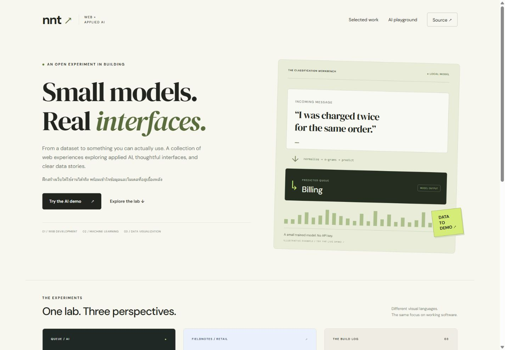
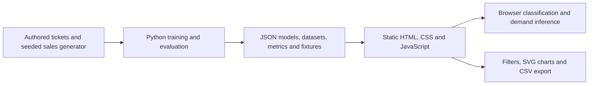

# Applied AI & Web Lab

โปรเจกต์เตรียมพอร์ตฝึกงานสาย Web Developer + Applied AI: เว็บ 3 สไตล์ โมเดลที่ฝึกและเรียกใช้ได้จริง พร้อมข้อมูลตัวอย่าง วิธีประเมิน และข้อจำกัดที่ตรวจสอบได้

A small, reproducible portfolio lab connecting web interfaces, fitted machine learning models, and data visualization. Two models run directly in the browser from exported JSON weights. All examples use hand-authored or generated synthetic data.



**Repository:** `nnt2525/applied-ai-web-lab`  
**Expected GitHub Pages address:** [nnt2525.github.io/applied-ai-web-lab](https://nnt2525.github.io/applied-ai-web-lab/) — deployment has not yet been verified.

## Three web experiences

| Page | Visual direction | Working interaction |
| --- | --- | --- |
| [The lab](web/index.html) | Light editorial portfolio | Project navigation and an overview of the data → model → interface workflow |
| [Queue](web/support.html) | Dark AI workbench | Thai/English ticket classification, example prompts, model scores, and abstention |
| [Fieldnotes](web/analytics.html) | SaaS analytics dashboard | Period/category/channel filters, SVG charts, product totals, filtered CSV export, and a demand-model scenario form |

The support model suggests `account`, `billing`, `delivery`, or `technical`, with a separate abstention decision. The analytics scenario predicts daily units from a date and an assumed lag-7 sales value. It also shows held-out predictions against a same-day-last-week baseline.

## Run locally

Requires **Node.js 20+**. There are **zero npm dependencies**; no package installation or API key is needed.

```sh
git clone https://github.com/nnt2525/applied-ai-web-lab.git
cd applied-ai-web-lab
npm run dev
```

Open [localhost:4173](http://localhost:4173). The server serves `web/`; use HTTP rather than opening the HTML files directly so JSON loading works.

```sh
npm test
npm run check
```

The JavaScript tests cover data aggregation and browser inference, including agreement with Python reference predictions. The static check verifies JavaScript syntax, JSON parsing, page metadata, and local HTML asset links. These checks complement manual browser and accessibility review.

To regenerate the datasets, fitted models, reference fixtures, and metrics, use **Python 3.10+** with the standard library only:

```sh
python -m ml.train
python -m unittest discover -s tests -v
```

Run commands from the repository root. Exported artifacts are committed, so Python is only required when retraining or running pipeline tests.

## Models and measured limits

### Bilingual ticket routing

Multinomial Naive Bayes uses character 2–4-gram counts, a vocabulary fitted on training examples, and development-selected rejection thresholds. The 160 authored tickets are grouped into semantic families so translations and paraphrases from one family stay in the same split.

| Measure | Result |
| --- | ---: |
| Train / development / test examples | 96 / 32 / 32 |
| Train / development / test semantic families | 24 / 8 / 8 |
| Closed-set test macro-F1, before abstention | 1.0000 |
| Majority baseline macro-F1 | 0.1000 |
| Accepted in-domain test examples | 31 / 32 |
| Correct among accepted in-domain examples | 31 / 31 |
| Rejected unrelated test requests | **3 / 6** |

The perfect closed-set result comes from a tiny, easy synthetic dataset. It does not establish real customer accuracy. Half of the unrelated test requests are incorrectly accepted, and Naive Bayes posteriors can be overconfident; the displayed score is uncalibrated. The model routes messages and executes no support actions.

The source ticket schema is `id`, `label`, `family`, `split`, `language`, and `text`. The exported classifier contains its classes, vocabulary, log priors, log likelihoods, and rejection thresholds.

### Daily demand regression

Ridge regression predicts total daily units from a trend, calendar cycles, a known promotion flag, and observed units seven days earlier. Training-only scaling and development-only alpha selection precede test evaluation.

| Measure | Result |
| --- | ---: |
| Chronological train / development / test days, after lag warm-up | 120 / 28 / 28 |
| Test MAE, ridge model | **3.8833 units/day** |
| Test MAE, same-day-last-week baseline | 7.8571 units/day |
| Test RMSE, ridge model | 4.9542 units/day |
| Test RMSE, baseline | 9.4188 units/day |

This is retrospective one-step evaluation using observed lag-7 values, including observations from earlier test dates as they become history. It is not a single 28-day forecast issued in advance. Synthetic data deliberately contains learnable patterns; the scenario form assumes a lag value and provides no prediction interval.

Exact results, split dates, methods, and failure examples are recorded in [the model cards](docs/MODEL_CARD.md) and [generated metrics](data/metrics.json).

## Architecture and data



| Directory | Responsibility |
| --- | --- |
| `web/` | Three pages, shared styling, JavaScript inference, and exported browser artifacts |
| `ml/` | Dataset generation, model fitting, chronological/family splits, and evaluation |
| `data/` | Reproducible source data and metrics |
| `tests/` | Python pipeline invariants and JavaScript inference/analysis checks |
| `scripts/` | Local static server and asset checks |
| `docs/` | Model cards, portfolio roadmap, and GitHub Education guidance |

The sales generator creates 2,196 product/channel/day aggregates over 183 days. Prices, costs, transactions, tickets, and business patterns are invented. Dashboard gross profit subtracts product cost only. See [the data dictionary and provenance](data/README.md).

Inference uses locally loaded model files. This prototype has no paid API dependency, remote inference service, application database, or authentication layer.

## Portfolio use and next steps

This starter was created with AI assistance. Review the code, reproduce the metrics, test failure cases, and make changes you can explain before presenting it as portfolio work. Describe your own contributions, the assistance received, and the current limitations honestly.

The current scope is an educational prototype. A useful next iteration is to:

1. Collect consented, deidentified real examples and independently labeled evaluation data; compare against these baselines.
2. Add an API with input validation, timeouts, logging, and integration tests.
3. Add a database and authentication when a defined user workflow needs persistence and access control.
4. Evaluate calibration, domain shifts, and prediction uncertainty; verify deployment and the complete browser-to-service flow.

Further guidance: [แผนพอร์ตและเตรียมสัมภาษณ์](docs/PORTFOLIO_PLAN_TH.md) · [สมัคร GitHub Education สำหรับนักศึกษา](docs/GITHUB_EDUCATION_TH.md).
